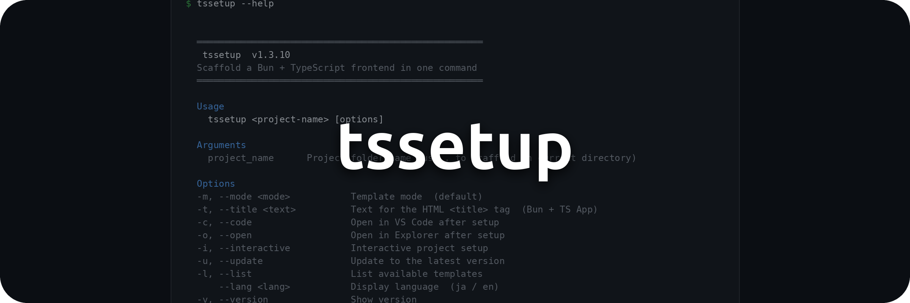

<div align="center">

<p align="center">
  
</p>

<p align="center"><b>English</b> | <a href="README.ja.md">日本語</a></p>

<h1 align="center">tssetup</h1>

<h3 align="center">Scaffold a Bun + TypeScript frontend project with one command.</h3>

<p align="center">Creates a Bun + TypeScript project with a hot-reload dev server from PowerShell or CMD. Pair it with <a href="https://github.com/Lapius7/tsbuild">tsbuild</a> to run it.</p>

<p align="center">
  <a href="https://www.npmjs.com/package/@lapius/tssetup"></a>
  <a href="https://pypi.org/project/tssetup/"></a>
  <a href="https://bun.sh"></a>
  <a href="LICENSE"></a>
  <a href="https://github.com/Lapius7/tssetup/stargazers"></a>
  <a href="https://github.com/Lapius7/tssetup/commits/main"></a>
</p>

<p align="center"><a href="#quick-start">Quick start</a> · <a href="#options">Options</a> · <a href="#templates">Templates</a> · <a href="#update">Update</a></p>

</div>

---

## Features

- **Instant start**: creates the folder, runs `bun init`, sets up `tsconfig.json` and writes the hot-reload server script.
- **Templates**: `default`, `tailwind`, `router`, `three`, `alpine`, `bootstrap` and `empty` (see [Templates](#templates)).
- **Editor hand-off**: `--code` opens the new project in VS Code, `--open` in Explorer.
- **Interactive mode**: `-i` asks for the settings step by step.
- **Update check**: shows a notice when a newer version exists.

## Quick start

You need **Python 3.9+** and **Bun**. VS Code is optional, for `--code`.

```sh
pnpm add -g @lapius/tssetup
# or
pip install tssetup
```

> [!NOTE]
> The npm package is built for pnpm. Do not install it with both npm and pnpm, or the same command exists twice. The npm package is a launcher that runs the Python tool, so it also needs Node.js 18 or later.

```sh
tssetup my-app                        # default template
tssetup my-app --mode tailwind --code # Tailwind CSS, then open VS Code
tssetup my-app --mode router --title "My SPA"
tssetup my-app --mode empty           # minimal
tssetup .                             # scaffold in the current directory
tssetup -i                            # interactive
```

After it finishes, the shell moves into the new project. Run [`tsbuild`](https://github.com/Lapius7/tsbuild) there to start developing. Run `tssetup` with no arguments to see the version and info screen.

| Tool | Used for | Install |
|---|---|---|
| Python 3.9+ | Running tssetup | [python.org](https://www.python.org/) |
| Bun | Project init and TypeScript compile | `powershell -c "irm bun.sh/install.ps1 \| iex"` |
| VS Code (optional) | `--code` | [code.visualstudio.com](https://code.visualstudio.com/) |

## Options

```sh
tssetup <project-name> [--mode <mode>] [--title <text>] [--code]
```

| Option | Short | Default | What it does |
|---|---|---|---|
| `project_name` | | required | Project folder name (`.` for the current directory) |
| `--mode <mode>` | `-m` | `default` | Template mode |
| `--title <text>` | `-t` | `Bun + TS App` | Text for the HTML `<title>` |
| `--code` | `-c` | | Open in VS Code after setup |
| `--open` | `-o` | | Open in Explorer after setup |
| `--interactive` | `-i` | | Set the project up interactively |
| `--list` | `-l` | | List available templates |
| `--update` | `-u` | | Update to the latest version |
| `--lang <lang>` | | | Display language: `ja` or `en` |
| `--version` | `-v` | | Show the version |
| `--help` | `-h` | | Show help |

## Templates

| Mode | What you get |
|---|---|
| `default` | Simple layout with Destyle.css and dark mode |
| `tailwind` | Tailwind CSS (CDN) ready to use |
| `router` | Small SPA router built on the HTML5 History API, no library |
| `three` | Three.js (CDN) with a rotating cube |
| `alpine` | Alpine.js (CDN) reactive UI demo |
| `bootstrap` | Bootstrap 5 (CDN) with a dark theme and a counter |
| `empty` | Empty TypeScript file and simple HTML |

## What it creates

```
my-app/
├── src/
│   └── index.ts        ← entry point (content depends on --mode)
├── dist/               ← JS output from tsc
├── node_modules/       ← from bun install
├── index.html          ← frontend HTML
├── server.ts           ← dev server with hot reload
├── tsconfig.json       ← TypeScript config
└── package.json        ← Bun project config
```

## Update

```sh
tssetup --update
```

Or reinstall: `pnpm add -g @lapius/tssetup` / `pip install --upgrade tssetup`.

## Safety

> [!NOTE]
> The README and PyPI metadata say Windows (PowerShell, CMD, Windows Terminal). Linux and macOS have not been verified for this README. The `three`, `alpine` and `bootstrap` templates were added after the old README and were checked against the code only, not generated and run here.

The software is provided as is, and the author takes no responsibility for any damage from using it.

## Contact

- X: [@Lapius7](https://x.com/Lapius7)
- [GitHub Issues](https://github.com/Lapius7/tssetup/issues)

## License

[MIT](LICENSE) © 2026 Lapius7
